# 操作系统实验报告

## 实验基本信息

| 项目 | 内容 |
|------|------|
| 实验名称 | Lab2：物理内存管理与页表 |
| 小组成员 | 2414077—胡欣如、2414097—王宣贺、2414137—史启航 |
| 报告整理日期 | 2026-10-22 |
| 对应工程 | `OS2026-064-lab2` |
| 实现范围 | 物理页初始化、Best Fit 连续物理页分配；分析 First Fit、Sv39 启动映射与 QEMU 地址转换记录 |

### 小组分工

| 成员 | 负责的练习/模块 | 报告分工 |
|------|----------------|----------|
| 2414077—胡欣如 | First Fit 与 Best Fit 策略对比、Best Fit 候选选择与分配分裂、basic_check 与 best_fit_check 断言分析、分配器测试结果核对 | 分配算法与分裂流程、Best Fit 关键断言、分配器测试说明、相关答辩问题 |
| 2414097—王宣贺 | 物理内存初始化、设备树内存信息解析、Page 数组布局与地址转换、内核和 DTB 保留区检查、伙伴系统设计与测试方案 | 整体逻辑分析、物理内存初始化模块、伙伴系统拓展设计、独立伙伴系统提示词 |
| 2414137—史启航 | 循环双向链表与释放合并流程、Sv39 启动映射、QEMU 地址转换与 TLB 调试记录分析、SLUB 分层设计 | 链表图解、释放合并说明、页表与 TLB 调试分析、SLUB 拓展设计及相关答辩问题 |

三人共同负责实验环境与构建结果核对、测试截图整理、实验基本信息与总结、报告汇总和终稿审阅。各成员分别整理所负责模块的提示词与答辩问题，并交叉核对代码和测试证据。分工覆盖分配与测试、初始化与保留区、回收与地址转换三个方向，每人均承担核心技术分析、验证及报告撰写任务。

## 一、实验目的

1. 理解操作系统如何取得物理内存范围，区分 RAM、内核占用区、页描述符区、设备树占用区与可分配区域。
2. 理解 `struct Page`、空闲块长度和循环双向链表之间的关系，掌握连续物理页的分配、分裂、释放与合并。
3. 对照 First Fit 实现 Best Fit，并通过能够区分两种策略的断言验证选择结果。
4. 理解 RISC-V Sv39 启动映射、`satp` 和虚实地址转换，结合已有调试记录分析页表与 QEMU 软件 TLB。
5. 用明确的接口和前置、后置条件组织 AI 协作提示词，区分已实现功能、已有测试证据和后续拓展设计。

## 二、实验环境

### AI 工具

本次报告整理使用 Codex 桌面应用辅助阅读源码、核对测试与整理说明。材料未记录原始代码开发会话的具体模型及各成员使用情况，因此不推测模型版本或个人使用记录。功能提示词见 [prompt.md](prompt.md)。

### 实验环境

| 项目 | 本次材料中的依据 |
|------|------------------|
| 开发环境 | 已有终端截图显示在 Windows 的 WSL 环境中操作，工程目录为 `/mnt/d/学习/大三上/操作系统/lab2_new` |
| 目标架构 | RISC-V 64 位；链接参数为 `elf64lriscv` |
| 编译工具链 | Makefile 使用 `riscv64-unknown-elf-` 前缀，未附本次编译器版本输出 |
| 模拟平台 | QEMU `virt`；MMU 调试截图中的源码路径为 `qemu-4.1.1` |
| 固件 | 启动截图显示 OpenSBI v0.4 |
| 内存 | 设备树解析结果为 128 MiB，物理范围 `[0x80000000, 0x88000000)` |
| 页大小 | `PGSIZE=4096`，`PGSHIFT=12` |
| 内核加载物理地址 | `0x80200000` |
| 内核链接虚拟地址 | `0xffffffffc0200000` |
| 直接映射偏移 | `PHYSICAL_MEMORY_OFFSET=0xffffffff40000000` |
| 当前分配器 | `best_fit_pmm_manager` |

本文的运行结果引用随工程提供的截图，并与源码交叉核对；本次报告整理没有重新执行 RISC-V 构建和 QEMU 测试。截图中的地址、空闲页数属于该次构建，后续代码变化可能改变这些数值。

## 三、实验整体逻辑分析

### 3.1 本章节的逻辑主线

Lab1 解决内核启动与输出问题；Lab2 进一步解决“内核如何知道有哪些内存，以及如何将空闲内存安全地分配出去”。主线是：建立启动映射，接收设备树信息，建立每个物理页的描述符，排除已占用区域，最后通过统一管理器接口进行连续物理页分配和回收。

```text
QEMU 布置内存和内核 → OpenSBI 交接
    ↓ a0：hartid，a1：DTB 物理地址
kern_entry：保存启动参数，设置 satp，建立高地址执行环境
    ↓
kern_init：清零 BSS → dtb_init → 控制台与内核信息输出
    ↓
pmm_init
    ├─ init_pmm_manager：选择 Best Fit，初始化空闲链表
    ├─ page_init：建立 Page 数组，保留占用区域，注册空闲页
    ├─ check_alloc_page：执行 best_fit_check
    └─ 记录并输出启动页表的虚拟、物理地址
```

### 3.2 功能的逐步实现

1. `kern/init/entry.S` 保存固件传来的启动参数，使用静态页表配置 `satp`，再跳转到高地址的 `kern_init`。
2. `kern/driver/dtb.c` 解析设备树 `memory` 节点的 `reg` 属性，取得 RAM 起点和长度。
3. `kern/mm/pmm.c` 在内核结束位置之后安排 `Page` 数组，先将全部描述页设为保留，再注册真正可分配的完整页。
4. `kern/mm/best_fit_pmm.c` 用按地址递增的循环双向链表记录空闲块，申请时选择最小够用块，释放时合并相邻空闲块。
5. 内置 `basic_check`、`best_fit_check` 检查分配行为；评分流程在临时副本中注入额外测试。

页表解决“访问某个虚拟地址时落到哪个物理地址”的问题；物理页分配器解决“哪些物理页空闲、这次给调用者哪些页”的问题。二者配合工作，但不是同一个模块。

## 四、实验内容与实现

### 4.1 功能模块一：物理内存初始化

#### 模块功能描述

相关文件：[pmm.c](../code/kern/mm/pmm.c)、[dtb.c](../code/kern/driver/dtb.c)、[pmm.h](../code/kern/mm/pmm.h)。核心接口为：

```c
uint64_t get_memory_base(void);
uint64_t get_memory_size(void);
static void page_init(void);
static void init_memmap(struct Page *base, size_t n);
```

#### 操作系统如何知道物理内存在哪里

本工程通过启动参数与设备树取得信息，没有通过遍历地址、尝试读写来探测 RAM。`kern_entry` 将 `a1` 保存到 `boot_dtb`；`dtb_init` 将 DTB 物理地址加上直接映射偏移，得到内核可访问的虚拟地址，然后验证魔数、转换大端字段、寻找 `memory` 节点的 `reg` 属性。解析结果保存到 `memory_base` 和 `memory_size`，由两个查询函数提供给 `page_init`。

截图中的结果是：

```text
boot_dtb = 0x82200000
memory_base = 0x80000000
memory_size = 0x08000000
RAM = [0x80000000, 0x88000000)
```

因此，“平台提供硬件描述，内核解析并建立管理结构”是本实验的答案。源码同时要求 `base == DRAM_BASE`，说明该实现依赖当前平台布局。设备树解析器也是简化版本，按两个 64 位值读取第一段内存范围，没有实现任意 `#address-cells`、多段 RAM 和全部保留区规则。

#### 页号、描述符与地址转换

```c
npage = PPN(limit);
size_t count = npage - nbase;
pages = (struct Page *)ROUNDUP((uintptr_t)end, PGSIZE);
```

这里 `npage` 表示物理内存结束位置对应的页号上界，**不是 RAM 页数**。128 MiB 对应 32768 页，但：

```text
nbase = 0x80000000 >> 12 = 0x80000
npage = 0x88000000 >> 12 = 0x88000
count = npage - nbase = 0x8000 = 32768
```

`pages[i]` 是第 `i` 个物理页的管理信息，不是那一页的实际存储空间。源码中的转换关系为：

```text
Page* → 物理页号：page - pages + nbase
Page* → 物理地址：(page - pages + nbase) << 12
物理地址 → Page*：&pages[(pa >> 12) - nbase]
直接映射虚拟地址 = 物理地址 + va_pa_offset
```

例如 `pages[0]` 描述 `0x80000000` 开始的一页，但 `pages` 数组本身放在内核结束后的另一段内存中。`pa2page` 的现有检查只判断页号上界，调用者还必须保证地址不低于 `DRAM_BASE`；它不是任意输入都安全的通用转换函数。

#### 初始化步骤与保留区域

1. 从设备树取出 `base`、`size`，设置映射偏移，检查 RAM 起点、长度以及不超过 1 GiB 的启动映射限制。
2. 计算 `limit`、`npage` 和描述符个数，将 `pages` 放在 `end` 向上按页对齐的位置。
3. 检查描述符数组容量，避免其越过 RAM 末尾；空闲起点必须在整个数组之后，再向上页对齐。
4. 遍历所有描述符，将引用计数与 `property` 清零，并设置 `PageReserved`。
5. 若 DTB 位于 RAM 内，读取其总长度，将覆盖范围向外扩展到完整页，从候选空闲区中排除。
6. 将 DTB 前后仍存在的非空区间交给 `init_memmap`，由分配器清除保留状态并建立空闲块。

```text
物理地址由低到高
RAM 起点
  │ 固件等前置保留区 │ 内核 │ 对齐空隙 │ Page 数组 │ 对齐空隙 │
  └────────────────────── 均不进入空闲链表 ──────────────────┘
                                                           free_start
                                                              │ 空闲区 A │ DTB 保留页 │ 空闲区 B │
                                                                                         free_end
```

图中 DTB 位于候选空闲区内，是已有启动记录所对应的布局；代码也处理 DTB 不与候选空闲区重叠的情况。不能简单把 `end` 之后全部内存标为空闲，否则可能覆盖页描述符或设备树。

#### 最终提示词与实现说明

完整四段式提示词见 [prompt.md：物理内存初始化模块](prompt.md#提示词一物理内存初始化模块)。核心要求是保持现有接口，正确区分虚拟地址、物理地址和页号，保护内核、描述符和 DTB，注册互不重叠的完整空闲页。

本次材料只保留最终代码，没有完整开发日志，因而无法确认实际迭代次数。最终代码可确认的关键处理包括：描述符空间检查、RAM 范围检查、先保留后释放的初始化方式，以及 DTB 跨页保护。它们是源码已经具备的行为，不能据此虚构曾出现过哪些错误或进行了几轮修复。

### 4.2 基础结构：Page 与循环双向链表

相关文件：[memlayout.h](../code/kern/mm/memlayout.h)、[list.h](../code/libs/list.h)。

```c
struct list_entry {
    struct list_entry *prev, *next;
};
typedef struct list_entry list_entry_t;

struct Page {
    int ref;
    uint64_t flags;
    unsigned int property;
    list_entry_t page_link;
};

typedef struct {
    list_entry_t free_list;
    unsigned int nr_free;
} free_area_t;
```

| 字段 | 含义 |
|------|------|
| `prev`、`next` | 前一个、后一个链表节点的地址 |
| `ref` | 物理页引用计数 |
| `flags` | 页状态位，包括保留标志和空闲块头标志 |
| `property` | 在有效空闲块头上表示该块连续空闲页的数量 |
| `page_link` | 嵌入 Page 内部的链表节点 |
| `free_list` | 链表哨兵头，不表示一个实际物理页 |
| `nr_free` | 全部空闲块包含的页数总和，不是链表节点数 |

#### 空链表是什么样的

初始化代码是：

```c
elm->prev = elm->next = elm;
```

设链表头为 H，空表和非空表的连接关系为：

```text
空表：
H.next = &H
H.prev = &H

只有一个节点 A：
H.next = &A      A.next = &H
H.prev = &A      A.prev = &H

两个节点 A、B：
next 方向：H → A → B → H
prev 方向：H → B → A → H
```

因此空表不是 `NULL`。本工程 `list_empty` 的实现检查 `list->next == list`；在链表连接正确的前提下，头节点指向自己就表示没有数据节点。一个节点也不是空表，因为 `H.next` 指向 A。

#### 为什么不是每个空闲页都挂在链表上

链表保存的是**每个连续空闲块的首个 Page 的 `page_link`**。例如一个 5 页空闲块，只需要一个链表节点，块头记录 `property=5`。中间四页仍有各自的 Page 描述符，但不单独作为空闲块节点。

遍历得到的是 `list_entry_t *`，通过 `le2page(le, page_link)` 扣除成员在结构体中的偏移，找回包含它的 `struct Page *`。哨兵头不属于 Page，必须先判断是否回到 `&free_list`，再使用 `le2page`。

还需要区分“链表相邻”和“物理相邻”：两个节点在链表上相邻，仅表示它们是按地址排序的相邻空闲块；中间可能隔着已分配页。只有 `前块起点 + 前块长度 == 后块起点` 才能合并。

#### 插入与删除改变了什么

向 A 与 B 之间插入 X，要建立 `A.next=X`、`X.prev=A`、`X.next=B`、`B.prev=X` 四个连接。删除 X 时，只需让 A 和 B 重新连接。源码中 `list_add` 插在指定节点之后，`list_add_before` 插在之前。

`list_del` 仅把节点从原链表摘下，不把被删节点重新设为自环。因此不能用 `list_empty(&被删节点)` 判断它是否已摘下；需要重新初始化时使用 `list_del_init`。

### 4.3 功能模块二：First Fit 分析与 Best Fit 实现

#### 统一管理器接口

`pmm_manager` 用函数指针统一初始化、注册、申请、释放、计数与自检接口。当前 `init_pmm_manager` 明确选择：

```c
pmm_manager = &best_fit_pmm_manager;
```

因此实际启动调用的是 Best Fit。`default_pmm.c` 中保留 First Fit，可以作为比较对象；文件存在不表示两种策略同时管理同一片内存。

#### First Fit 的选择方式

`default_alloc_pages` 从低地址向高地址扫描空闲块，遇到第一个 `property >= n` 的块就选中并退出。若块大于申请长度，从低地址端取出 n 页，将剩余部分重新作为空闲块挂回原位置。

这种策略的“首次”指链表遍历顺序中的第一个合适块。本工程链表按地址递增排列，所以通常是地址最靠前的够用块。总空闲页够多仍可能分配失败，因为申请要求连续页。

#### Best Fit 的选择方式

相关文件：[best_fit_pmm.c](../code/kern/mm/best_fit_pmm.c)。关键选择逻辑为：

```c
if (p->property >= n &&
    (page == NULL || p->property < page->property)) {
    page = p;
    if (p->property == n) {
        break;
    }
}
```

候选块必须够用，并且比已有候选更小，才替换候选；遇到精确匹配时已经不可能找到更小的够用块，可以提前退出。链表按地址排序、比较条件使用严格小于，所以同大小候选中保留最先遇到的低地址块。

**Best Fit 不要求链表按块大小排序。** 当前实现通过扫描选择最小够用块，同时维持地址顺序以方便释放合并。设空闲块数为 F，First Fit 最坏查找时间为 O(F)，Best Fit 最坏也为 O(F)，但后者通常需要比较更多候选。

#### 分配与分裂

选中块后，先保存其前驱，再删除原块头。若原块长 m 且 `m > n`，则：

```text
原空闲块：[ page .................................. ] m 页
分配后：  [ 已分配 n 页 ][ 剩余 m-n 页空闲块 ]
起点：      page          page+n
```

源码用 `p=page+n` 找到剩余块头，设置其 `property=m-n` 和 `PageProperty`，再插回原位置；最后 `nr_free -= n`，清除返回块头的 `PageProperty`。`page+n` 是 Page 数组中的指针运算，对应物理地址增加 `n*PGSIZE`，不是物理地址只增加 n 字节。

如果总空闲页不够，直接返回 `NULL`；如果总数足够但没有单个连续块够用，扫描后同样返回 `NULL`，不改变分配器状态。本实现不会自动清零被分配页的数据。

#### 释放与相邻合并

`best_fit_free_pages` 清除被释放页的状态并将引用计数置零，以 `base` 建立长度为 n 的空闲块，增加 `nr_free`，按地址插入链表，然后检查前后两侧：

```c
// 与前块相邻
if (p + p->property == base) { ... }

// 与后块相邻
if (base + base->property == p) { ... }
```

先合并前块时，必须执行 `base=p`，使后续检查从新的大块起点出发。合并删除多余块头，并清除其 `PageProperty`。释放只增加 n 个空闲页；合并改变的是块的数量，不应再次增加空闲页计数。

```text
释放前：[前侧空闲 2 页][本次释放 3 页][后侧空闲 1 页]
释放后：[                 空闲 6 页                 ]
```

循环中的断言可以拦截保留页或某些重复释放，但 `PageProperty=0` 也可能表示空闲块内部页，因此现有标志不能识别所有非法释放。正确性仍依赖调用者释放合法持有的连续区间。

#### 哪条断言证明选中的是 Best Fit

`best_fit_check` 的关键测试不是只检查“申请成功”，而是构造策略差异：

```c
free_pages(p0 + 1, 2);
free_pages(p0 + 4, 1);
assert(alloc_pages(4) == NULL);
assert(PageProperty(p0 + 1) && p0[1].property == 2);
assert((p1 = alloc_pages(1)) != NULL);
assert(alloc_pages(2) != NULL);
assert(p0 + 4 == p1);
```

初始的 5 页中，释放后的状态是：

```text
页下标：  0     1     2     3     4
状态：   占用   空闲  空闲   占用  空闲
空闲块：       [ 2 页 ]          [1页]
```

申请 1 页时，First Fit 会选择靠前的 2 页块，返回 `p0+1`；Best Fit 应选择精确匹配的 1 页块，返回 `p0+4`。因此直接体现选择结果的是 **`assert(p0 + 4 == p1);`**。

前一条 `assert(alloc_pages(2) != NULL);` 也有区分作用：正确选择后，2 页块仍完整可用；若误用 First Fit，剩下两个互不相连的 1 页块，后续 2 页申请就失败。答辩时应连同这段构造一起解释，不能把单条断言当作对所有输入的完整证明。

#### 最终提示词与实现说明

完整提示词见 [prompt.md：最佳适配连续物理页分配模块](prompt.md#提示词二最佳适配连续物理页分配模块)。其要求涵盖接口兼容、最小够用选择、同大小低地址优先、分裂、双侧合并、计数守恒及失败不改变状态。

源码中已实现上述核心流程，并保留框架检查函数。材料没有开发过程日志，故不编造迭代次数；第五节分别记录内置检查和评分脚本能支持的结论。

### 4.4 Sv39 启动映射与地址转换分析

相关文件：[entry.S](../code/kern/init/entry.S)、[kernel.ld](../code/tools/kernel.ld)。

#### satp 与静态根页表

启动代码取得 `boot_page_table_sv39` 的虚拟地址，减去直接映射偏移得到物理地址，再右移 12 位得到根页表物理页号，并与 `8 << 60` 合并写入 `satp`。随后执行 `sfence.vma`，设置高地址栈并跳转到 `kern_init`。

根页表共 512 项，每项 8 字节，大小为 4 KiB。前 511 项为零，最后一项是：

```asm
.quad (0x80000 << 10) | 0xcf
```

其值为 `0x200000cf`，物理页号为 `0x80000`，V、R、W、X、A、D 位置位。由于根级表项本身已经允许读写执行，它是 **1 GiB 大页叶子项**，将从 `0xffffffffc0000000` 开始的高地址区域映射到物理区间 `[0x80000000, 0xc0000000)`。

更直观地说，虚拟起点为 `0xffffffffc0000000`，映射长度为 1 GiB。Sv39 支持三级页表，不代表每次地址转换都必须访问三级；当前映射在根级就结束。映射范围也不等于实际 RAM 范围，物理页分配仍以设备树报告的 128 MiB 为准。

#### 从已有记录还原一次转换

截图给出的内核地址为 `0xffffffffc02000d6`，根页表物理地址为 `0x80205000`。计算过程为：

```text
VPN[2] = (VA >> 30) & 0x1ff = 511
PTE 地址 = 0x80205000 + 511 × 8 = 0x80205ff8
PTE = 0x200000cf
大页物理基址 = 0x80000000
大页内偏移 = VA & 0x3fffffff = 0x002000d6
最终物理地址 = 0x802000d6
```

转换截图中的 `*physical=0x80200000` 是该观察点输出的 4 KiB 页基址；完整字节地址还应加上低 12 位偏移 `0xd6`。不能把截图中的页基址直接当作整条指令的最终字节地址。

#### Bare 状态与软件 TLB

复位阶段截图显示 `satp=0`、QEMU 局部变量 `mode=3`、访问地址 `0x1000`，物理地址也为 `0x1000`。这里 `mode=3` 表示机器态，不能把它误认为 `satp.MODE=3`；该次访问没有执行 Sv39 页表遍历。

即使没有分页转换，QEMU 仍可将访问结果填入软件 TLB，以加速后续对模拟内存的访问。截图中的 `addend` 属于 QEMU 宿主地址计算信息，不是内核使用的 `PHYSICAL_MEMORY_OFFSET`。Sv39 记录显示页标签 `0xffffffffc0200000` 与访问地址的页基址一致，随后进入命中分支，说明已有翻译可以复用。上述判断来自对应调试截图；通用 Sv39 语义可参照 [RISC-V 特权架构文档](https://docs.riscv.org/reference/isa/priv/supervisor.html)。

### 4.5 拓展设计：伙伴系统与 SLUB

**本节是设计分析，当前提交代码未包含伙伴系统或 SLUB 实现，也没有对应运行测试。** `pmm.c` 的框架注释提到了 buddy，但实际管理器表和源文件中没有对应实现，不能把注释当作完成证据。

#### 伙伴系统的设计思路

可按阶数 k 维护空闲链表，每个块包含 `2^k` 个连续页。申请 n 页时计算最小满足 `2^k >= n` 的阶数；若该阶为空，寻找更高阶块并逐级对半分裂。释放时仅当另一个块与当前块同阶、空闲、属于同一受管区域且互为伙伴，才向上一阶合并。

若以对齐区域起点为基准、当前块起始页下标为 i，则伙伴下标可用 `i XOR (1 << k)` 计算。必须先保证区域划分与相对对齐成立；地址相邻的两块不一定是伙伴。例如 8 页区域中的两个 2 页块 `[2,4)` 与 `[4,6)` 虽相邻，却不是同一个 4 页父块的两个子块，不能合并。

接入本工程时尤其要处理 DTB 形成的空洞，以及不为二次幂的初始空闲区。每个合法连续区间应拆成对齐且不越界的二次幂块，不能跨保留页合并。还要明确接口语义：例如申请 3 页实际占用 4 页，就必须保存分配阶数，使释放时归还完整 4 页，而不是直接沿用任意页数释放规则。

这种分裂与合并原则可参考 [Linux 物理页分配说明](https://kernel.org/doc/gorman/html/understand/understand009.html)；这里提出的是与本实验接口衔接的方案，不代表已移植 Linux 实现。

#### 伙伴系统测试如何设计

应先在一个隔离、已知大小且对齐的区域内测试，避免其他空闲块干扰预期结果，再扩展到实际 RAM：

| 测试项 | 测试构造 | 应检查的结果 |
|--------|----------|--------------|
| 精确阶申请 | 从 8 页区域申请 8 页 | 不分裂，空闲页数减 8；再次申请失败 |
| 连续分裂 | 从 8 页区域申请 1 页 | 剩余 1、2、4 页块各一块，无重叠、无丢失 |
| 向上取整 | 申请 3 页 | 若采用阶分配，应占用 4 页，释放也恢复 4 页 |
| 递归合并 | 分配两个互为伙伴的 1 页块，再依次释放 | 两块释放后可逐级恢复原大块 |
| 非伙伴不合并 | 构造同阶相邻但不互为伙伴的空闲块 | 不进行错误合并 |
| 碎片失败 | 8 页全部分配后，仅释放交错的 4 个单页 | 总空闲 4 页，但 2 页申请仍失败 |
| 区域边界 | 保留 DTB 或区域中部页面 | 结果不覆盖保留页，不跨空洞合并 |
| 耗尽与恢复 | 分配至失败，再按不同顺序全部释放 | 最终计数及空闲块结构恢复，失败不修改状态 |
| 数据隔离 | 向已分配块写入不同模式，穿插其他申请和释放 | 未释放块数据保持不变 |

每步还应核对 `sum(各阶空闲块数 × 2^阶数) == nr_free_pages()`。如果采用“分裂时总是返回低地址半块”的规则，1 页申请后应剩余 `[1,2)`、`[2,4)`、`[4,8)`；未约定方向时，应检查大小和不变量，不硬编码返回地址。

#### SLUB 的实现流程应如何说明

单次只需要几十字节的对象，如果直接消耗一整页，会浪费空间。教学版 SLUB 可在页分配器之上，按对象大小建立缓存，从底层申请页作为 slab，再把 slab 切分为多个对齐的对象槽。其基本流程为：

```text
初始化对象缓存
  → 计算对象槽大小、对齐和可容纳数量
申请对象
  → 当前 slab 有空闲槽：从 freelist 取一个
  → 当前 slab 已满：查找尚未用满的 slab
  → 没有可用 slab：向物理页分配器申请页，初始化后取对象
释放对象
  → 定位所属 slab 和缓存，归还 freelist，减少使用计数
  → slab 完全空闲：按缓存策略保留复用，或把整块页归还底层
```

需要管理对象大小、所属 slab、空闲对象链、总槽数和已使用数，并确保元数据不与对象重叠。对象槽还要能容纳 freelist 指针。可以先采用单页 slab，便于用页边界定位元数据；多页 slab 则需额外维护页到 slab 的归属关系。

本工程当前底层是 Best Fit；教学对象分配器也可以先调用它的 `alloc_pages`。若之后改用伙伴系统，必须同步记录并按正确阶数归还页块。实际 Linux SLUB 还涉及并发和 CPU 本地缓存等机制，不应将上述单核简化方案说成完整 Linux SLUB。对象缓存与 slab 分层的基本思想可参考 [内核 Slab 分配说明](https://www.kernel.org/doc/gorman/html/understand/understand011.html)。

## 五、测试与验证

### 5.1 现有检查的覆盖范围

| 检查项 | 代码或证据 | 可支持的结论 |
|--------|------------|--------------|
| 编译与链接 | `images/build.png` | 截图显示完成编译、链接和裸镜像生成 |
| 启动 | `images/lab2-boot.png` | DTB 解析成功，启用 Best Fit，打印内置检查成功 |
| 基础分配 | `basic_check` | 不同单页分配结果、引用计数、地址范围、空表失败与页复用 |
| Best Fit 行为 | `best_fit_check` | 小块优先、保留较大连续块、恢复后空闲块数量和页数一致 |
| 初始化评分 | `test_page_init` | 偏移、页号、描述符位置、计数合理性、部分保留状态和转换往返 |
| 管理器评分 | `test_best_fit` | 当前管理器指针确为 `best_fit_pmm_manager` |
| 综合评分截图 | `images/grade.png` | 本工程所附评分脚本输出 20/20 |
| 伙伴系统、SLUB | 没有实现与运行证据 | 仅给出设计与待执行测试，不计入通过项 |

`test_best_fit` 本身只比较管理器指针，并没有重复测试全部分配行为；行为检查来自它之前调用的 `check_alloc_page → best_fit_check`。`test_page_init` 检查了内核尾页和描述符起始页的保留标志，但未穷举全部保留页，也未独立覆盖所有 DTB 边界情况。评分通过应理解为通过所附测试，不能扩大为所有边界和并发场景都已验证。

### 5.2 构建、运行与评分截图

**编译结果。** 截图显示编译各模块、链接 `bin/kernel` 并生成 `bin/ucore.img`。同时有文件时间戳略晚于当前时间的警告，不能写成“完全没有警告”。

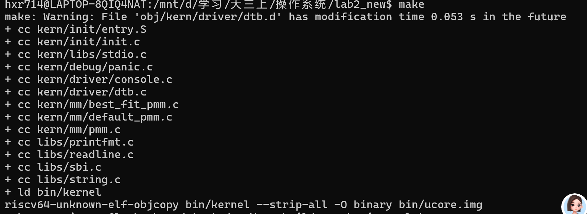

**启动结果。** 输出包括设备树地址、128 MiB RAM、Best Fit 管理器、31928 个初始空闲页，以及 `check_alloc_page() succeeded!`。

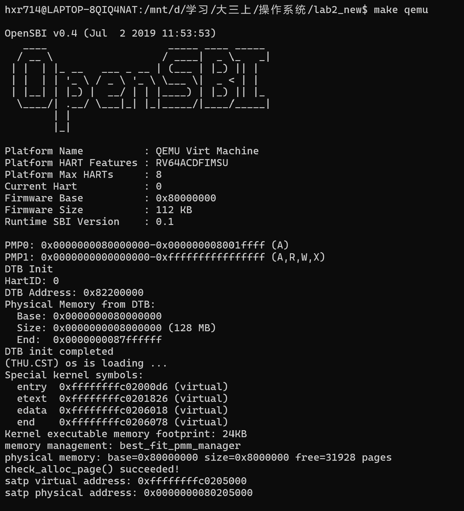

截图还给出 `end=0xffffffffc0206078`，因此描述符数组起点应向上对齐到 `0xffffffffc0207000`。按本工程 RV64 常规布局，Page 大小为 40 字节，32768 个描述符占 320 页，候选空闲起点为物理地址 `0x80347000`。由此算得候选空闲页数为 31929，与截图中的 31928 相差 1 页，符合该次 DTB 另占一页的结果。这是根据源码与截图进行的交叉校验；截图没有直接展示 DTB 总长度，不能将该推算替代独立的长度测量。

**评分结果。** 截图显示初始化和 Best Fit 两项均为 OK，总分 20/20。

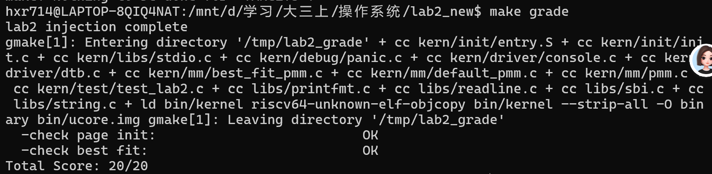

### 5.3 地址转换与 TLB 调试记录

**未分页的复位访问：** 状态截图显示 `satp=0`、访问地址 `0x1000`；转换截图显示物理地址仍为 `0x1000`。

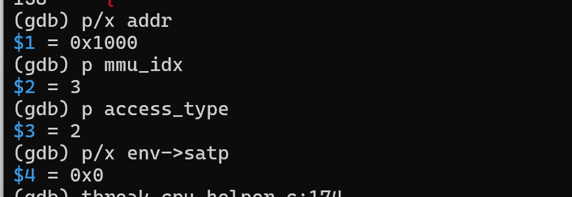

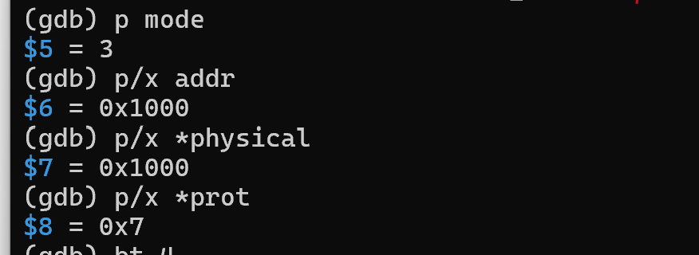

**软件 TLB 填充：** 截图显示虚拟、物理页地址均为 `0x1000`，填充大小为 4096 字节，随后记录页标签和宿主访问偏移。中间的 `No symbol "addr" in current context` 是 GDB 局部变量作用域问题，改为当前函数的 `paddr` 后可观察值，不是内核崩溃。

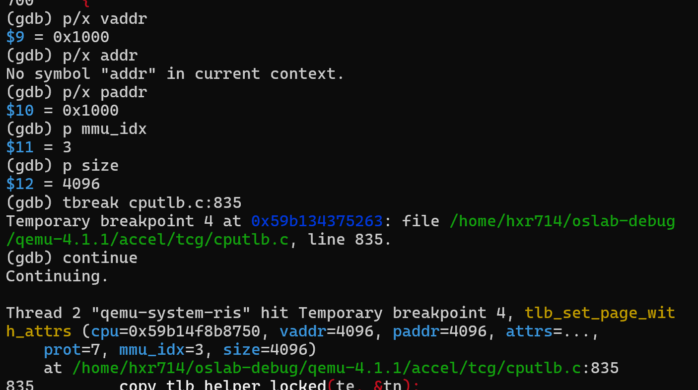

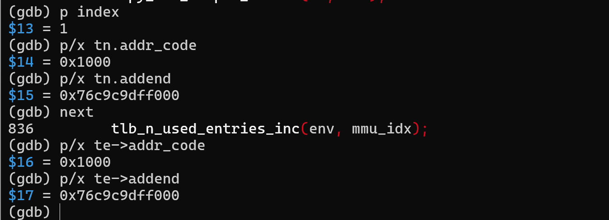

**Sv39 根页表与叶子项：** 根表地址、索引和表项数值与启动汇编一致。

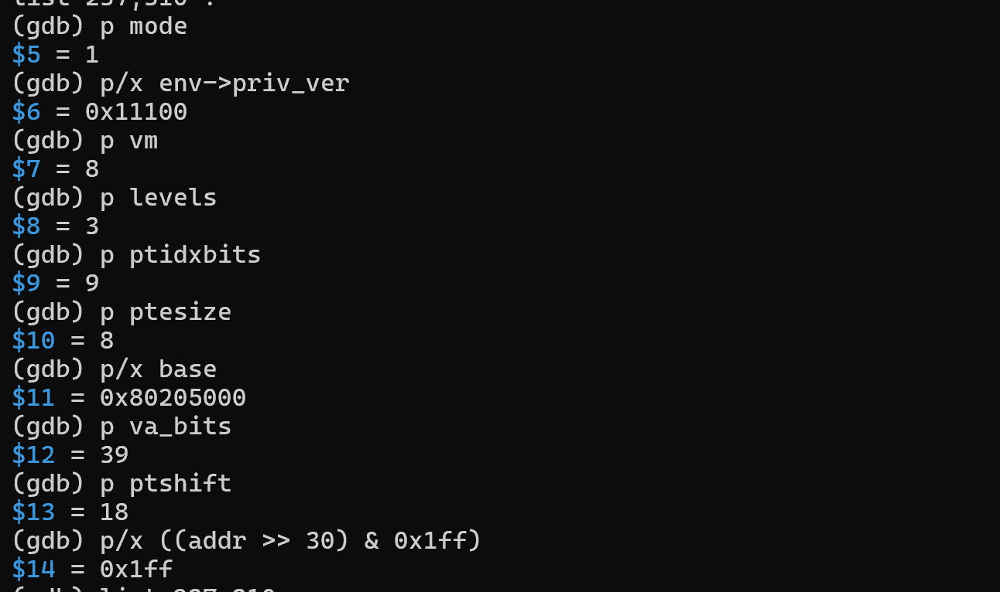

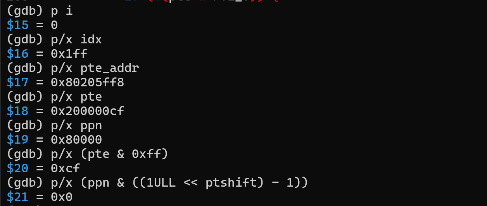

**翻译结果与命中：** 页基址转换为 `0x80200000`，后续相同虚拟页访问进入 TLB 命中路径。

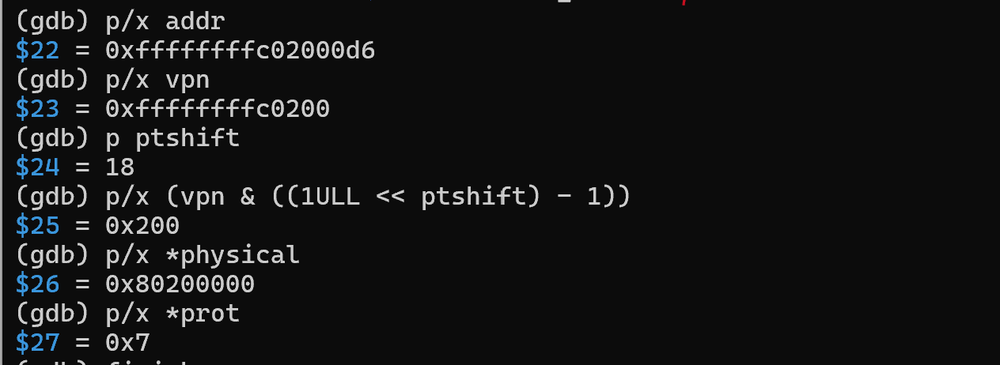

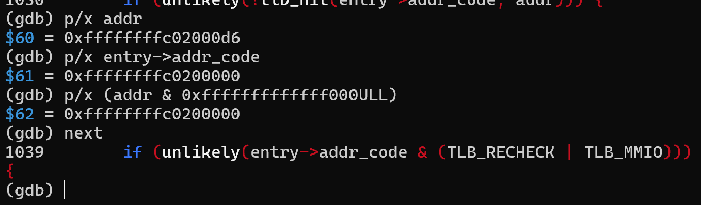

### 5.4 复现方法与限制

在配置好课程工具链和匹配 QEMU 的 Linux/WSL 环境中，从 `code` 目录执行：

```bash
make
make qemu
make grade
```

Makefile 的启动方式为 `-device loader,file=bin/ucore.img,addr=0x80200000`，不应机械照抄 Lab1 的 `-kernel` 启动描述。`make grade` 在 `/tmp/lab2_grade` 创建临时工程副本并注入测试，不直接向原始源码注入测试代码。

客体内核调试可使用 `make debug` 和另一终端的 `make gdb`。工程中 `tools/startup.gdb` 是遗留 Lab1 脚本，不能原样用来证明 Lab2 高地址初始化流程。观察 QEMU 内部 `env->satp`、`tlb_set_page_with_attrs` 等内容，还需要带调试信息的 QEMU 与宿主 GDB；这些变量不是内核自身的变量。

后续值得补充的验证包括：多个等长候选块、总数足够但连续块不足、释放的前侧/后侧/双侧合并、DTB 跨页边界以及不同 RAM 长度。本文未把这些建议记为已经执行的新增测试。

## 六、实验总结与收获

### 对操作系统的理解

| 实验知识点 | 对应 OS 原理 | 本实验的范围与限制 |
|------------|--------------|--------------------|
| DTB 内存信息 | 平台发现与启动约定 | 简化解析单段 RAM，未支持全部设备树保留规则 |
| Page 数组 | 物理页元数据管理 | 描述符与实际物理页分离，描述符自身也占内存 |
| 空闲循环链表 | 空闲空间组织 | 每个节点代表一个连续块，计数单位是页 |
| First Fit / Best Fit | 连续分配策略与外部碎片 | Best Fit 选择当前最小够用块，不保证未来碎片最少 |
| 释放合并 | 连续空间恢复 | 必须检查物理相邻，不是链表相邻就能合并 |
| Sv39 大页映射 | 虚拟内存与地址翻译 | 当前为静态根级大页，未建立用户地址空间 |
| TLB | 地址转换缓存 | 已有记录观察的是 QEMU 软件实现 |
| 伙伴系统与 SLUB | 页分配与对象分配分层 | 当前是拓展方案，没有代码实现与测试结果 |

本实验把“机器拥有的内存”“内核能够寻址的范围”和“当前能够分配的页”区分开来。设备树报告 RAM 范围，页表提供访问路径，物理页管理器再扣除保留区域并维护空闲集合。三者不能相互替代。

链表理解的关键在于明确三个对象：哨兵头负责组织链表，Page 保存物理页元数据，Page 内嵌的 `page_link` 负责连接。`property` 记录块长度，因此不需要把每个空闲页都独立连接；地址排序则使释放时只检查前后邻块成为可能。

### AI 协作开发的经验

提示词应描述可检验的行为，而不只是“实现一个 Best Fit”。例如，同大小候选如何选择、申请失败是否改变状态、释放时是否双侧合并，以及 DTB 覆盖页是否受到保护，都应成为明确条件。

另一方面，测试结论必须对应真实证据。管理器名称正确不等于算法一定正确；评分通过不等于未实现的 Challenge 也通过；最终源码不能反推出开发迭代次数。本报告据此分别呈现源码分析、已有运行记录和拓展设计，使报告与提交工程一致。

