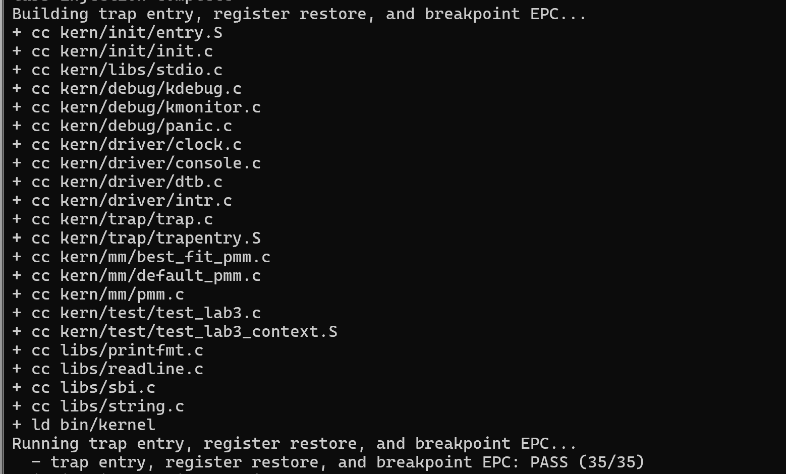
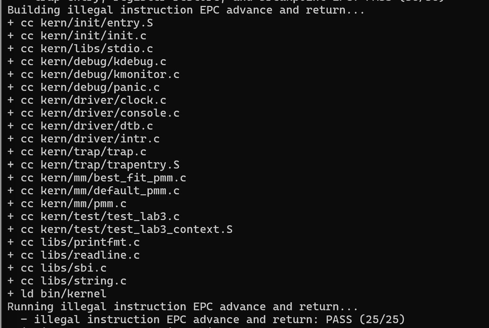
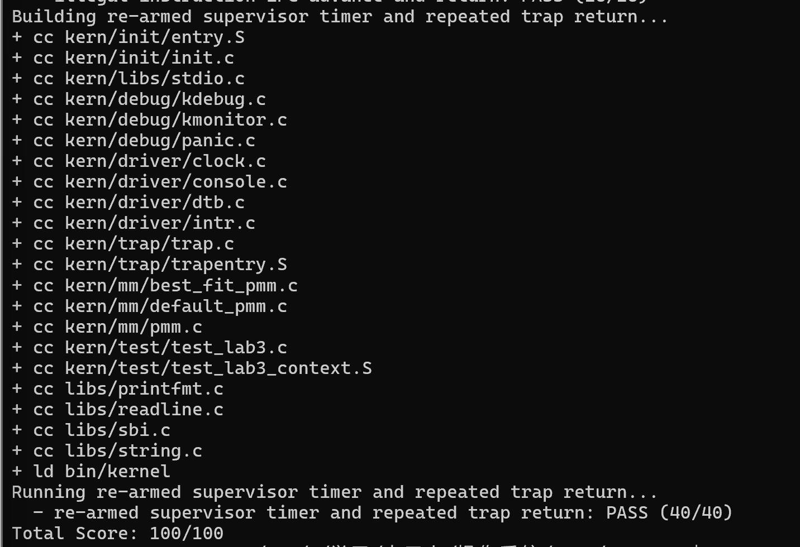
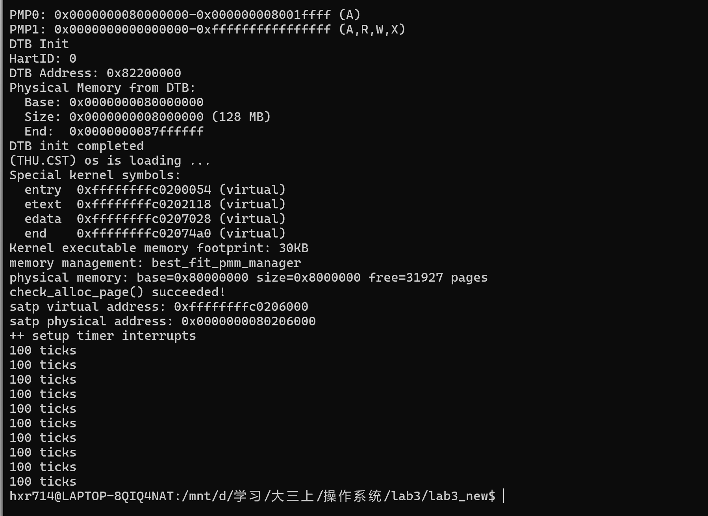

# 操作系统实验报告

## Lab3 · 中断与异常处理

| 项目 | 内容 |
| :--- | :--- |
| 小组成员 | 2414077—胡欣如、2414097—王宣贺、2414137—史启航 |
| 对应工程 | OS2026-064-lab3 |
| 报告日期 | 2026-11-02 |
| 实验内容 | Trap 入口与现场恢复、断点与非法指令处理、时钟中断与自动关机 |
| 测试结果 | 所附评分截图为 100/100；普通启动截图显示十次周期输出后返回终端 |

## 小组分工

本次实验的小组分工如下。

| 成员 | 负责的练习与模块 | 报告与验证分工 |
| :--- | :--- | :--- |
| 2414077—胡欣如 | 中断与异常分派；断点、非法指令的输出与 EPC 更新；指令长度判断 | 整理异常处理实现与提示词，核对非法指令测试及后备处理分支，分析异常返回条件 |
| 2414097—王宣贺 | Lab2 物理内存初始化与 Best Fit 承接；分配接口的中断保护；内核初始化顺序 | 整理实验环境、启动流程与内存管理承接部分，核对启动截图中的地址、空闲页数及页面自检结果 |
| 2414137—史启航 | Trap 汇编入口、现场布局与寄存器恢复；时钟重设、周期统计与自动关机 | 整理现场保存恢复和时钟处理部分，核对寄存器测试、连续时钟评分及十次周期输出，分析测试覆盖范围 |

共同工作包括：交叉核对汇编槽位与 C 结构体、检查测试结论与截图是否一致、汇总四段式提示词、统一报告格式并完成终稿审阅。

## 一、实验目的

Lab2 中，我们已经能够管理空闲物理页；Lab3 要解决的是内核运行过程中被打断后，如何处理事件并正确回到原来的执行位置。这里的“正确返回”不仅指程序没有崩溃，还包括通用寄存器、栈指针、特权状态和返回地址都与处理逻辑一致。

本实验围绕三个问题展开：第一，汇编入口怎样把处理器现场组织成 C 函数能够访问的结构体；第二，时钟中断和同步异常为什么采用不同的返回地址处理方式；第三，怎样通过实际触发和重复返回验证整条链路，而不是只检查一条输出。

## 二、实验环境与工程结构

| 项目 | 配置与依据 |
| :--- | :--- |
| 运行环境 | 截图显示 Windows 下的 WSL 终端 |
| 目标架构 | RISC-V 64 位，链接格式 `elf64lriscv` |
| 编译工具链 | Makefile 使用 `riscv64-unknown-elf-` 前缀 |
| 模拟平台 | QEMU `virt`，`-bios default` 加载固件 |
| 内核加载方式 | `-device loader,file=bin/ucore.img,addr=0x80200000` |
| 物理内存 | 128 MiB，范围 `[0x80000000, 0x88000000)` |
| 页大小与分配器 | 4096 字节；`best_fit_pmm_manager` |
| 时钟设置 | 每次将下一事件设为当前 `rdtime` 值加 100000 |

源码中最需要连起来阅读的是以下几组文件。

| 文件 | 在实验中的作用 |
| :--- | :--- |
| `kern/init/init.c` | 串联初始化、时钟配置和全局中断使能 |
| `kern/trap/trapentry.S` | 保存现场、调用 C 处理函数、恢复现场并执行 `sret` |
| `kern/trap/trap.h` | 定义与汇编槽位一一对应的 `trapframe` |
| `kern/trap/trap.c` | 设置入口、分派原因、处理时钟及指定异常 |
| `kern/driver/clock.c`、`intr.c` | 设置定时事件、控制中断使能 |
| `kern/mm/pmm.c`、`kern/sync/sync.h` | 延续 Lab2 内存管理，并保留中断临界区 |
| `tools/test_lab3.c`、`test_lab3_context.S` | 构造异常、检查寄存器、等待连续时钟事件 |
| `tools/inject.py`、`grade.sh` | 在临时工程中插入测试并汇总评分 |

本报告依据提交源码及四张原始截图整理，未在报告整理环境重新编译运行。

## 三、从启动到 Trap 返回

### 3.1 初始化的实际顺序

`kern_init()` 先清零 BSS，再解析 DTB，随后初始化控制台并输出内核信息。当前代码在 `pmm_init()` 前后各调用了一次 `idt_init()`，之后才执行 `clock_init()` 和 `intr_enable()`。第二次入口初始化重复写入同样的入口地址；评分注入脚本选择最后一次 `idt_init()` 后插入异常测试。

```text
清零 BSS → DTB 与控制台初始化
    ↓
idt_init → pmm_init → idt_init
    ↓                    └─ 评分副本在此插入断点/非法指令测试
clock_init：允许 S 态时钟中断，设置首次事件，ticks 清零
    ↓
intr_enable：设置 sstatus.SIE
    ↓
普通内核进入循环，等待中断
```

`idt_init` 是框架保留的函数名。实际实现写入的是 RISC-V 的 `stvec`，不是建立 x86 的中断描述符表。`__alltraps` 按四字节对齐，直接写入后使用 Direct 模式，所有进入 S 态的 Trap 先到同一个汇编入口。

### 3.2 一次 Trap 的完整路径

```text
时钟到期或执行异常指令
    ↓ 处理器记录 sepc / scause / stval，更新 sstatus
__alltraps
    ↓ SAVE_ALL：在当前栈建立 288 字节现场
mv a0, sp → call trap
    ↓
trap_dispatch
    ├─ 中断：interrupt_handler
    └─ 异常：exception_handler
    ↓
__trapret → RESTORE_ALL → sret
    ↓
从恢复后的 sepc 继续执行
```

硬件负责记录 Trap 原因和控制状态，通用寄存器的保存则由软件完成。C 函数接收的 `tf` 就指向栈上的这份现场，因此修改 `tf->epc` 会影响最后写回的 `sepc`，不需要另外传递一个返回地址。

## 四、Trap 现场的保存与恢复

### 4.1 汇编与结构体如何对应

`struct trapframe` 先放置 32 个通用寄存器槽，再放置 `status`、`epc`、`badvaddr` 和 `cause`。RV64 下每个槽为 8 字节，总计 `36 × 8 = 288` 字节。

| 内容 | 槽位 | 相对当前 sp 的字节偏移 |
| :--- | :--- | :--- |
| x0 | 0 | 0 |
| ra（x1） | 1 | 8 |
| Trap 前的 sp（x2） | 2 | 16 |
| x3～x31 | 3～31 | 24～248 |
| sstatus | 32 | 256 |
| sepc | 33 | 264 |
| stval，结构体沿用 badvaddr 名称 | 34 | 272 |
| scause | 35 | 280 |

设进入 Trap 时栈指针为 S，分配现场后 `sp = S - 288`，而槽 2 保存的值仍然是 S。288 是 16 的整数倍，因此入口原有的 16 字节栈对齐不会因分配现场而被破坏。

### 4.2 为什么先把 sp 写入 sscratch

`SAVE_ALL` 开始时执行：

```asm
csrw sscratch, sp
addi sp, sp, -36 * REGBYTES
```

这两条指令先保留原栈指针，再腾出现场空间。随后保存通用寄存器，最后通过 `csrrw s0, sscratch, x0` 取出原 sp，并同时清零 `sscratch`。原 sp 被写入槽 2。

此时使用 `s0`～`s4` 临时读取 CSR 是安全的，因为它们原来的值已经存入对应槽位。顺序若颠倒，保存的就会变成读 CSR 后的临时值。

本工程直接在当前内核栈上建立现场，没有实现从用户栈切换到独立内核栈的完整流程。源码中的 `sscratch` 注释表达了区分来源的设计意图，但不能据此认为当前入口已经支持完整的用户态 Trap 切栈。

### 4.3 汇编怎样调用 C 函数

```asm
SAVE_ALL
mv a0, sp
call trap
```

`a0` 是第一个参数寄存器，将 sp 复制到 a0 后，`trap(struct trapframe *tf)` 就能按结构体字段访问现场。`call` 会改写 ra，C 函数也会使用参数和临时寄存器，但这些变化不会覆盖栈中已经保存的原值。正常 C 调用返回后，sp 仍指向入口建立的现场，执行流自然落到 `__trapret`。

### 4.4 恢复顺序的关键

恢复先加载槽 32、33，把它们写回 `sstatus` 和 `sepc`，随后恢复通用寄存器，最后恢复 x2。

```asm
LOAD t0, 32*REGBYTES(sp)
LOAD t1, 33*REGBYTES(sp)
csrw sstatus, t0
csrw sepc, t1
# 按槽位恢复 x1、x3～x31
LOAD x2, 2*REGBYTES(sp)
sret
```

这里有两个容易遗漏的细节。其一，t0、t1 也属于被打断程序的现场；它们用于搬运 CSR 后，还要从槽 5、6 恢复。其二，其他加载指令都以当前 sp 为基址，如果提前恢复 x2，后续加载就会跑到原栈位置读取错误数据。最后直接加载原 sp 后，也不再需要额外执行 `addi sp, sp, 288`。

`x0` 恒为零，不需要恢复。`scause` 和 `stval` 用于诊断本次 Trap，不参与这里的返回控制，因此恢复路径没有把它们写回。真正完成特权返回的是 `sret`；普通 `ret` 只能按 ra 跳转，不能替代它。

Trap 进入时，原中断使能状态保存在 SPIE 中，SIE 被清除；`sret` 再根据保存的状态恢复执行级别和中断使能。恢复的是 Trap 入口记录的状态，不能随意把 SIE 强制设为 1。

## 五、中断与异常的分类处理

### 5.1 scause 的最高位与原因编号

`trap_dispatch()` 把 `cause` 转为有符号整数，根据是否小于零区分中断和异常。这对应 RV64 的最高位：置位表示中断，其余低位表示原因编号。

进入 `interrupt_handler()` 后，代码先清除最高位，再执行 `switch`：

```c
uintptr_t cause = tf->cause &
    ~((uintptr_t)1 << (sizeof(uintptr_t) * 8 - 1));
```

以 S 态时钟中断为例，最高位与低位编号共同组成 `scause`。如果直接拿整个值与 `IRQ_S_TIMER` 比较，就无法匹配只包含原因编号的常量。

除时钟外，代码还为软件中断和外部中断保留提示分支。它们目前主要用于分类输出，没有完整处理设备确认或中断源清除，因此这些分支的存在不等于实现了相应设备驱动。

### 5.2 时钟为什么必须反复设置

`clock_init()` 使能 `sie` 中的时钟位，设置首次事件并清零 ticks；全局 SIE 在后面的 `intr_enable()` 中打开。`clock_set_next_event()` 的实现是：

```c
sbi_set_timer(get_cycles() + timebase);
```

`get_cycles()` 实际使用 `rdtime`，而 `timebase` 在本文件中表示事件间隔 100000，并非动态读取的平台频率。SBI 接口接收下一次事件的绝对时间，因此每次处理中断都要设置新的截止时间。

```c
clock_set_next_event();
ticks++;
if (ticks % TICK_NUM == 0) {
    print_ticks();
    if (++printed_periods >= SHUTDOWN_AFTER) {
        sbi_shutdown();
    }
}
```

默认 `TICK_NUM=100`，`SHUTDOWN_AFTER=10`。ticks 记录中断次数，printed_periods 记录统计输出次数：第 100 次中断打印第一行，第 1000 次打印第十行并调用关机接口。每一行都是固定文字 `100 ticks`，并非把累计次数反复重置为 100。

按源码注释采用的 QEMU 10 MHz 时间基准，100000 个计数约为 10 ms，100 次中断约为 1 s。但本次没有独立计时数据，且下一事件以“当前时间加间隔”设置，处理延迟会影响长期周期，不能把十行输出写成精确的十秒测量结果。

时钟是异步事件，处理完成后应继续被打断的执行流，所以该分支不修改 EPC。否则会无故跳过正常指令。

### 5.3 断点与非法指令为什么要更新 EPC

断点和非法指令异常的 EPC 指向触发异常的指令。在本实验选择的“输出信息后跳过”处理策略下，如果 EPC 不变，`sret` 返回就会再次触发同一异常。

代码先打印原 EPC，再读取指令的起始半字判断长度：

```c
uint16_t first = *(volatile const uint16_t *)(uintptr_t)tf->epc;
if ((first & 3) != 3) {
    tf->epc += 2;
} else if ((first & 0x1f) != 0x1f) {
    tf->epc += 4;
} else {
    panic("unsupported instruction length at 0x%016lx",
          (unsigned long)tf->epc);
}
```

| 编码判断 | 处理 |
| :--- | :--- |
| 低两位不是 11 | 按 16 位指令跳过 2 字节 |
| 低两位为 11，低五位不是 11111 | 按 32 位指令跳过 4 字节 |
| 其余编码 | 当前实现不支持，进入 panic |

不能简单把“断点”固定对应 2 字节、“非法指令”固定对应 4 字节，因为异常类型和指令长度不是一回事。评分使用的非法指令是 `.word 0x0000007b`，低五位为 `11011`，会走加 4 的路径。

读取半字能避免仅为识别压缩指令而多读两个字节，但仍要求 EPC 对应内存可读。当前实现针对已映射的内核指令，不是任意地址下都安全的取指器。其他异常只打印现场；例如缺页没有补建映射，返回后可能再次触发，不能套用本实验的跳过策略。

## 六、Lab2 代码的承接与中断保护

本次保留 DTB 内存解析、页描述符初始化和 Best Fit。`page_init()` 先把描述页全部设为保留，再把内核、描述符数组和 DTB 之外的完整物理页登记为空闲。Best Fit 仍按地址组织空闲块，申请时寻找最小够用块，释放时合并物理相邻区间。Lab2 的 Buddy、SLUB 扩展没有出现在本次工程中。

Lab3 中需要额外注意的是公共分配接口外层的中断保护：

```c
bool intr_flag;
local_intr_save(intr_flag);
page = pmm_manager->alloc_pages(n);
local_intr_restore(intr_flag);
```

`free_pages()` 和 `nr_free_pages()` 也采用同样结构。保存函数先检查 SIE，只有原来打开时才关闭并返回真；恢复函数也仅在原来打开时重新使能。这保证调用者本来处在关中断状态时，不会因一次分配操作意外打开中断。

链表摘除、分裂和计数更新由多步操作构成，临界区避免本 hart 的可屏蔽中断处理在中间状态进入。它不屏蔽同步异常，也不能阻止其他 hart 并发访问，因此不是多核锁的替代品。

## 七、测试方法与截图分析

### 7.1 评分如何进行

`make grade` 先清理构建产物，将工程复制到 `/tmp/lab3_grade`，再由 `inject.py` 插入测试。脚本分别以三个宏干净构建、运行 QEMU，并检查串口日志中的通过标记及必要输出。异常测试位于最后一次 `idt_init()` 后；时钟检查分别插在 `clock_init()` 和 `intr_enable()` 后。

| 测试 | 实际检查内容 | 截图结果 |
| :--- | :--- | :--- |
| Trap 入口与断点返回 | 预置寄存器，执行 ebreak，返回后逐项比较；检查断点输出 | 35/35 |
| 非法指令返回 | 执行 0x0000007b，继续运行；调用其他处理分支并检查日志 | 25/25 |
| 连续时钟 | 开启前检查 ticks；等待 ticks 达到 200，检查周期输出及通过标记 | 40/40 |

图 1～3 是评分脚本的汇总画面，能直接确认各项分数。异常地址等客体细节没有完整出现在这些截图中，具体测试路径由测试源码和脚本共同说明。

### 7.2 入口与上下文恢复：35/35



图 1 显示测试源码参与编译，内核完成链接，随后输出 `PASS (35/35)`。汇编测试给 t0～t6、s0～s11、a1～a7 共 26 个寄存器写入不同值，执行 `ebreak` 后逐个比较。这样的构造可以发现恢复偏移错误或漏恢复某个寄存器，而单纯看到断点输出无法说明这些问题。

测试没有给 gp、tp 改写哨兵值，也没有对原 a0、ra、sp 做同样的逐项比较。成功返回能间接支持返回链路有效；完整恢复范围还需对照 `SAVE_ALL` 和 `RESTORE_ALL` 的槽位核查。因此本报告不把 35/35 表述为“所有寄存器都经过独立断言验证”。

### 7.3 非法指令与后备分支：25/25



图 2 底部显示 `PASS (25/25)`。测试先执行四字节非法编码，能继续到后续 C 代码，说明这条测试路径完成了异常处理和返回。

后续通过人工构造 `trapframe` 直接调用处理函数，覆盖 S 态软件中断、未知中断编号 15，以及异常编号 20 的现场打印。这里验证的是函数分支与输出，不是硬件实际产生了所有这些 Trap。

当前测试没有分别用明确的 16 位与 32 位断点编码构成两组用例。源码实现了两种长度的判断，但不能仅凭一个 `ebreak` 源码助记符认定两条长度分支都已运行验证。

### 7.4 连续时钟与总分：40/40、100/100



图 3 显示时钟项 `PASS (40/40)` 和 `Total Score: 100/100`。测试等待 ticks 达到 200，脚本还要求日志包含 `100 ticks` 与 `ticks=200`。这比只验证第一次中断更有效：如果没有重新设置事件，或某次返回破坏了现场，主程序就难以到达这一通过条件。

100/100 是提交包内评分脚本所定义的三项总分。脚本主要通过日志模式判定，不能替代对嵌套异常、多核、用户态切栈及各种异常编码的专项测试。

### 7.5 普通启动与自动关机



普通运行图比评分图提供了更多启动细节：DTB 地址为 `0x82200000`，RAM 为 128 MiB，当前管理器为 Best Fit，初始空闲页为 31927，并出现 `check_alloc_page() succeeded!`。页表虚拟地址为 `0xffffffffc0206000`，物理地址为 `0x80206000`。

这两个地址之差正好是源码中的直接映射偏移 `0xffffffff40000000`。截图中的 `end=0xffffffffc02074a0` 向上按页对齐后为 `0xffffffffc0208000`，对应描述符起点 `0x80208000`。按当前 RV64 结构体布局，32768 个 40 字节 Page 占 320 页，可分配候选区从 `0x80348000` 开始，至 `0x88000000` 共 31928 页。截图少一页，与 DTB 占用页被保留的实现相符；DTB 总长度未在截图中单独显示，因此这一处属于交叉推算。

时钟初始化后，原图可以数出十行 `100 ticks`，最后出现 WSL 命令提示符。结合默认计数阈值与 `sbi_shutdown()` 调用，可确认图中行为与“处理 1000 次时钟中断后结束运行”的设计一致。

### 7.6 复现步骤

在配置好课程交叉编译器和 QEMU 的 Linux/WSL 环境下，进入工程 `code` 目录执行：

```sh
make clean
make
make grade
make qemu
```

评分过程会清理原目录的构建产物，最后的 `make qemu` 会按依赖重新生成普通运行镜像。若需调试，可在两个终端分别执行 `make debug` 与 `make gdb`，观察 `__alltraps`、`trap` 和 `__trapret`。本报告的四张图均保留原始内容，没有把推算结果另行制作成运行截图。

## 八、实现问题与 AI 协作记录

### 8.1 旧 CSR 名称的兼容处理

包内已有记录提到汇编器报 `unknown CSR 'sbadaddr'`。最终 `trapentry.S` 在文件顶部通过条件宏将旧名称映射到 `CSR_SBADADDR`，对应 `stval` 的 CSR 编号 0x143。这样保留了原保存指令的写法和现场布局。

此处应区分名称兼容与布局错误：改名称解决汇编器识别问题，改偏移会影响 C 与汇编对同一份数据的解释。当前四张图片没有保留最初报错画面，故报错过程依据包内记录，最终修复则可直接从源码核对。

### 8.2 默认关机阈值

代码用 `#ifndef SHUTDOWN_AFTER` 提供默认值 10，允许外部宏覆盖。该补充使普通运行有明确终止条件。`print_ticks()` 还保留 `DEBUG_GRADE` 下的结束及 panic 分支，不过本包的三项评分使用 `GRADE_LAB3_*` 宏，不应把两套条件混为一谈。

### 8.3 提示词如何对应具体实现

完整四段式规格保存在同目录的 [prompt.md](prompt.md)，正文仅保留与代码分析有关的要点。

| 模块 | 提示词的核心约束 | 对应核验 |
| :--- | :--- | :--- |
| Lab2 承接 | 迁移初始化和 Best Fit，保留中断保护 | 公共接口仍调用 save/restore；普通启动自检成功 |
| 入口与恢复 | 不改变布局，传递帧地址，最后恢复 sp | 36 个槽位对照；断点寄存器测试 |
| 中断处理 | 去掉原因标志位，重设事件，周期计数 | 原因掩码；200 次时钟测试；十行输出 |
| 异常处理 | 根据编码更新 EPC，明确支持范围 | 半字读取与长度分支；四字节非法指令返回 |

AI 用于辅助阅读代码、整理规格和润色报告，具体模型版本与逐轮开发对话未保存在提交材料中。附带提示词是结构化整理文本，不当作逐字历史记录。核验时重点放在“程序为什么能继续运行”上：例如真正检查 sp 恢复顺序，或看 ticks 是否能达到 200，避免用一段流畅的解释代替执行证据。

## 九、实验总结

本实验最关键的对应关系是：汇编把寄存器写入固定槽位，C 按 `trapframe` 读取和修改这些槽位，返回汇编再把结果写回处理器。单独看每个函数都不长，但只要两边对某个偏移理解不同，错误就会在返回原程序后暴露。

时钟和异常的比较也说明，EPC 更新必须由事件语义决定。时钟处理保留返回位置；本实验的断点和非法指令选择越过触发指令；将来的缺页处理则可能在补好映射后重试原指令。不能把“异常处理完成”统一理解为 PC 加四。

从现有测试看，入口调用、指定寄存器恢复、断点与非法指令返回、持续时钟处理已经通过所附评分，普通启动也与默认关机条件一致。下一步若继续扩展，应优先补充明确的 16/32 位异常用例、对 sp 与其他未直接比较寄存器的检查，再考虑用户态切栈和嵌套 Trap。这样每增加一项机制，都有对应的测试来解释它是否真正工作。


