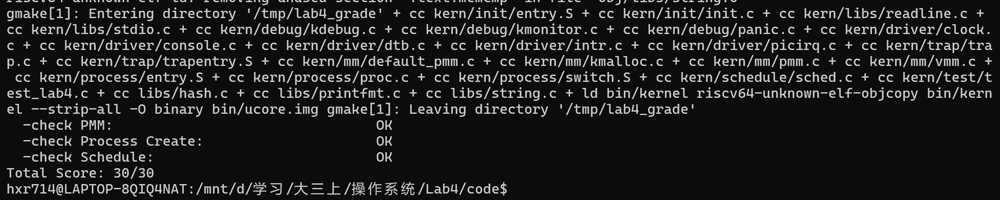
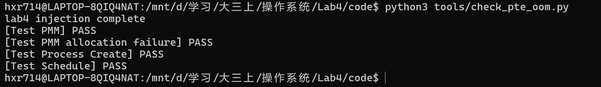
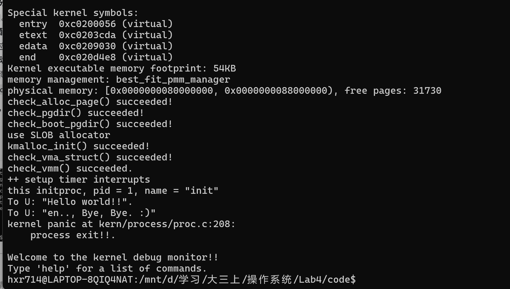

# Lab4 虚拟内存与内核线程实验报告

## 目录

- [一、实验目标与实现顺序](#一实验目标与实现顺序)
- [二、核心功能](#二核心功能)
  - [2.1 虚拟内存页操作](#21-虚拟内存页操作)
  - [2.2 内核线程创建](#22-内核线程创建)
  - [2.3 调度与上下文切换](#23-调度与上下文切换)
- [三、规格与提示词设计](#三规格与提示词设计)
- [四、AI 辅助核验与问题修复](#四ai-辅助核验与问题修复)
- [五、实验步骤与验证](#五实验步骤与验证)
  - [5.1 实验步骤](#51-实验步骤)
  - [5.2 验证命令与截图](#52-验证命令与截图)
- [六、Challenge](#六challenge)
- [七、实验知识与 OS 原理](#七实验知识与-os-原理)
- [八、尚未覆盖的 OS 原理](#八尚未覆盖的-os-原理)

## 一、实验目标与实现顺序

本实验先完善 Sv39 页映射操作，再创建内核线程，最后通过调度和上下文切换让线程获得 CPU。Lab2 提供物理页分配，Lab3 提供 Trap 现场恢复。内核在线程运行前建立所需映射，线程共享内核地址空间，各自拥有 PCB、内核栈和上下文。

```text
kern_init → pmm_init → pic_init / idt_init → vmm_init → proc_init
         → cpu_idle → schedule → proc_run → switch_to
```

这三个阶段解决的是连续的依赖。首先，物理页分配器回答“哪些页可以使用”，页表回答“内核用什么地址访问这些页”。两者准备好后，线程创建才能分配 PCB 和内核栈，并通过有效的内核地址写入新线程现场。其次，创建线程建立了可供调度的数据结构，线程进入 `PROC_RUNNABLE` 后才成为调度候选。最后，调度器选出候选，切换代码才把 CPU 的执行位置和栈真正交给它。

启动链可以分成两个观察阶段。前半段由 `pmm_init()` 准备物理内存与页表，`pic_init()` 和 `idt_init()` 准备中断相关环境，`vmm_init()` 检查虚拟区间管理。后半段由 `proc_init()` 建立 idle 和 init，启动执行流继续进入 `cpu_idle()`。idle 的初始重调度标记使它调用 `schedule()`，init 才有机会从已登记的线程变成实际运行的线程。QEMU 中看到 init 自己打印 PID，可以观察到这条执行链已经走到线程函数。

## 二、核心功能

### 2.1 虚拟内存页操作

从调用者角度看，`get_pte(pgdir, la, create)` 的结果是**末级页表项的位置**。即便指针非空，槽里的 V 位也可能为零。只有 `page_insert()` 写入目标物理页号及权限后，才形成有效映射。删除时传入 `create=0`，这样未建过页表路径的地址不会因为一次删除操作而消耗物理页。中间目录项记录下一级页表的位置，末级叶项才记录数据页位置。两者占用的物理页承担不同职责。

`mm_struct` 管理地址空间描述，`vma_struct` 描述一个虚拟区间。VMA 说明一段地址的范围和属性，硬件实际翻译依据页表项。启动时通过 `vmm_init()` 检查 VMA 的组织与查询。

`get_pte()` 按 Sv39 的三级索引定位末级 PTE。允许创建时可分配中间页表。如果已经创建一层、下一层却因物理页不足而失败，就撤销本次新建的目录项并归还该页，保留既有映射。

`page_insert()` 先确保路径存在，再增加新页引用。同一物理页重新映射时抵消这次增量并更新权限。替换成另一物理页时撤销旧映射，再写入新 PTE。成功更新后同步 TLB。路径创建失败时返回 `-E_NO_MEM`。

`page_remove()` 只查询已有路径。遇到有效映射才递减物理页引用、清除 PTE 并使旧翻译失效。引用降到零时归还物理页。无映射时直接返回，因此重复删除也安全。

页操作可以用一个具体例子理解。假设虚拟地址 A 已指向 P1，且只有这一个映射引用 P1。再次把 A 映射到 P1 时，只更新权限，引用数仍为 1。若改为 P2，P1 的引用由 1 降至 0，P2 增加一个映射引用，A 的 PTE 改为指向 P2。随后删除 A，P2 的引用再减一。CPU 可能缓存过 A 到 P1 的翻译，因此每次有效修改后都要同步 TLB。若建立页表路径失败，调用在增加目标页引用前返回，避免把一次失败计作已建立映射。

### 2.2 内核线程创建

idle 复用启动栈和正在执行的现场，因此初始化时直接将它设为 `current`。init 则经 `kernel_thread()` 创建，有单独分配的栈。这里可以把 PCB 中的几个字段对应起来：PID 用于标识实体，链表节点供调度器遍历，哈希节点供按 PID 查询，`kstack` 指向线程栈，`tf` 记录首次 Trap 返回所需的数据，`context` 记录调度切换所需的数据。把线程加入链表只是发布它的身份，唤醒才使它具备被选中的资格。

`do_fork()` 的清理顺序与资源获取顺序相反。例如 PCB 已申请而栈申请失败，只需要释放 PCB。如果后续步骤失败，则先归还栈，再释放 PCB。PID 分配、全局登记和唤醒位于准备阶段之后，因此这些准备失败的对象不会进入调度器的扫描范围。

`alloc_proc()` 初始化 PCB，状态为 `PROC_UNINIT`，PID 为 -1，页表指向内核启动页表。`proc_init()` 把当前启动现场包装为 PID 0 的 idle，并创建 PID 1 的 init。

`kernel_thread()` 将函数和参数准备到 TrapFrame 中，再调用 `do_fork()`。`do_fork()` 准备 PCB、内核栈和初始现场，成功后在关中断的临界区分配 PID、登记链表和哈希表、更新计数并唤醒线程。准备失败时释放已申请资源。`copy_mm()` 保留地址空间处理接口，本阶段线程共用内核页表。

`copy_thread()` 将 TrapFrame 放在新线程自己的栈上，并设置 `context.ra` 为 `forkret`。因此线程首次被切入时沿 `forkret → forkrets → __trapret → sret → kernel_thread_entry` 进入线程函数。

新线程还没有执行过，栈上没有可以自然返回的旧调用现场。为此，`kernel_thread()` 在临时 TrapFrame 的 `s0` 和 `s1` 中分别放入函数入口与参数，把 EPC 设为 `kernel_thread_entry`，并用 SPP、SPIE 指定首次返回的特权级和中断状态。随后 `copy_thread()` 将现场复制到新栈，并设置 `context.sp` 与 `context.ra`。第一次切入时，`switch_to()` 的 `ret` 进入 `forkret`。Trap 返回路径恢复预设寄存器后，`sret` 跳到线程入口汇编，由入口把参数放到 `a0` 并调用线程函数。

### 2.3 调度与上下文切换

假设链表顺序为 init、线程 A、线程 B，当前是 A。调度从 A 的后继开始检查。B 可运行时选 B，B 不可运行时越过链表头继续找 init。如果其他线程都不可运行，绕回后仍可能选回可运行的 A，此时只更新运行计数，省去切换。遍历没有任何普通候选时才选 idle。这个例子解释了为什么需要区分链表头、扫描起点和调度回退对象。

`cpu_idle()` 在需要重调度时调用 `schedule()`。调度器循环扫描进程链表，跳过链表头并选取 `PROC_RUNNABLE` 的线程，无候选时退回 idle。选中当前线程时无需切换。

`proc_run()` 在本地中断保护下更新 `current`，设置 Sv39 的 `satp` 并同步地址翻译，然后调用 `switch_to()`。`switch_to()` 保存和恢复 `ra`、`sp`、`s0` 至 `s11`，其偏移与 `struct context` 对应。这里的切换发生在函数调用边界，首次运行另通过 TrapFrame 恢复完整的初始状态。

考虑 idle 切到 init 的第一次调度。`schedule()` 在链表中发现 init 可运行，`proc_run()` 保存旧 `current` 并把它更新为 init，再装载目标页表。这里 `pgdir` 保存的是根页表物理地址，右移 `PGSHIFT` 得到物理页号，与 Sv39 模式位组合后写入 `satp`。最后 `switch_to()` 将旧栈与返回地址保存到 idle 的 context，并加载 init 的栈和返回地址。如果以后切回已经让出 CPU 的线程，则用它先前保存的返回地址继续执行，随后在原调用栈上恢复该次临界区保存的中断状态。

调度期间短暂关闭本地中断，是为了避免在 `current`、页表和寄存器现场尚未一致时进入中断处理。外层 `schedule()` 已经关中断时，内层 `proc_run()` 保存到的是关闭状态，内层恢复时不会提前打开中断。新线程首次进入则走预设 TrapFrame 的返回路径。

## 三、规格与提示词设计

每项练习按 Prompt、Rely、Guarantee、Specification 四段描述。Prompt 明确任务及改动边界，Rely 列出需要核对的最小依赖，Guarantee 固定接口，Specification 用可观察的状态变化和失败条件描述实现。以下是依据实际任务整理的可复用版本。见 [提示词汇总](prompt.md)。

| 练习 | 规格设计重点 |
| --- | --- |
| 页映射 | 区分空项、同页更新、异页替换、重复删除和内存不足，逐项写清 PTE、引用计数与 TLB 状态 |
| 线程创建 | 明确资源准备、全局登记和唤醒的先后关系，描述错误返回及清理责任 |
| 调度 | 明确可运行判定、idle 回退、中断状态恢复和首次执行路径 |
| Challenge | 以当前实现为依据解释中断状态的保存恢复和多级查表的重复结构，并说明适用边界 |

## 四、AI 辅助核验与问题修复

1. **中间页表创建只完成一半。** 在只够创建一级中间表时，额外测试的 `root[0] == 0` 断言曾失败。修复路径只撤销本次新增的空页表并归还其物理页。原有回归记录表明修复后通过。对应规格增加了“只够创建一层”和“保留已有映射”的验收条件。
2. **框架中的整数地址传给指针接口。** 实际评分在 `kmalloc.c` 停止编译。SLOB 保存的 `kva` 是整数地址，而 `kva2page()` 接受 `void *`。调用点加入显式转换 `kva2page((void *)kva)`，后一次编译已越过该文件。
3. **评分线程入口签名不一致。** 下一次编译在注入的测试文件中发现 `test_lab4_thread()` 返回 `void`，而 `kernel_thread()` 要求 `int (*)(void *)`。修复落在注入源文件 `tools/test_lab4.c`，将返回类型改为 `int`。测试线程内的无限调度循环没有正常返回路径，测试断言保持原样。

第 2、3 项属于实际构建发现的类型兼容问题。编译失败后没有生成评分内核，日志中的 `0/30` 来自测试未运行。两处修复后重新评分得到 `30/30`，见图 1。

## 五、实验步骤与验证

### 5.1 实验步骤

1. **核对框架与依赖。** 对照课程框架确认 Lab4 的补全位置，检查物理页分配和 Lab3 的 Trap 返回路径。先确认 `struct Page`、`struct context` 和 `struct trapframe` 的定义，再编写依赖布局的代码。
2. **完成页映射维护。** 在 `pmm.c` 补齐插入与删除。沿“查找槽位、维护页引用、更新 PTE、同步 TLB”检查正常流程，再单独检查没有空闲页与部分路径分配失败。
3. **准备可调度线程。** 在 `proc.c` 初始化 idle，准备 init 的 PCB、内核栈和 TrapFrame。检查准备完成后才登记和唤醒，并从首次返回入口追到真正的线程函数。
4. **接通调度和切换。** 在 `sched.c` 检查候选选择及 idle 回退，在 `proc_run()` 检查临界区与页表切换，在 `switch.S` 对照 context 字段核对每个寄存器偏移。
5. **分层验证。** 先以 `make grade` 查看三项基础功能，再运行内存耗尽测试检查失败路径，最后用普通 QEMU 启动观察 init 是否输出 PID。遇到编译错误时先定位首条错误并重新构建，再解读评分。

### 5.2 验证命令与截图

在 WSL 的 `/mnt/d/学习/大三上/操作系统/Lab4/code` 执行。

```bash
export PATH="/opt/course-riscv/riscv-elf-toolchains/bin:$PATH"
make grade
python3 tools/check_pte_oom.py
make qemu
```

| 验证 | 观察内容 |
| --- | --- |
| 基础评分 | PMM、Process Create、Schedule 三项结果与总分 |
| 页表分配失败 | `[Test PMM allocation failure] PASS`，对应部分创建回滚与已有映射保留 |
| 普通启动 | `initproc` 输出 PID 与名称，表明调度成功进入线程函数。当前演示线程返回会进入 `do_exit()` 的 panic 路径 |

**图 1　基础功能评分。** `make grade` 的 PMM、Process Create 和 Schedule 三项均为 `OK`，总分为 `30/30`。



**图 2　页表分配失败回滚。** `check_pte_oom.py` 输出 `[Test PMM allocation failure] PASS`，对应中间页表分配失败后的回滚检查。同一轮中基础页操作、进程创建和调度也均通过。



**图 3　普通 QEMU 启动。** 页表与 VMA 自检通过后，PID 为 1 的 `initproc` 打印线程名和传入的 `Hello world!!`，验证了首次调度和参数传递。线程函数返回后进入当前的 `do_exit()`，触发 `process exit!!.` 并进入内核调试监视器。



## 六、Challenge

保存中断状态时使用局部标志记住原 SIE，退出临界区按原状态恢复。嵌套调用时，内层保存到的是已关闭状态，退出内层后仍保持关闭，外层退出时才恢复原状态。

Sv32、Sv39、Sv48 分别使用二、三、四级页表。Sv39 的 `get_pte()` 两段相似代码分别完成从根表到中间表、从中间表到末级表的下降。两段都要取索引、检查有效位并按需建表。本实验保留 `create` 参数以共享遍历逻辑。接口复杂度增加时，可在对外接口区分纯查询与允许分配的操作，内部复用遍历过程。见 [完整 Challenge 解答](challenge.md)。

## 七、实验知识与 OS 原理

**虚拟内存的逻辑描述与硬件实现。** 在操作系统原理中，一段虚拟地址可以有完整的使用规则，而硬件只能读取页表和权限位。Lab4 中，VMA 表示区间，PTE 表示某个页的实际映射。理解这一层次关系后，就能解释为什么创建 VMA 不会自动建立所有 PTE，也能理解后续按需分页如何让区间存在而某些数据页尚未映射。

**资源所有权与缓存一致性。** 引用计数回答的是“是否还有映射使用这页”，TLB 同步回答的是“CPU 接下来是否会使用新翻译”。例如 A 从 P1 改为 P2 后，P1 的引用可能归零，同时 CPU 还可能持有旧翻译。释放资源和同步翻译是两项各有用途的工作。本实验关注本地地址翻译更新，多核环境还要协调使用该映射的其他 hart。

**两种现场保存的粒度。** Lab3 的 Trap 可以发生在被打断程序的执行边界，TrapFrame 保存恢复原执行所需的通用寄存器和控制信息。Lab4 的 `switch_to()` 在明确的函数调用边界执行，按 ABI 保存返回地址、栈和被调用者保存寄存器。一个新线程同时需要两种现场。调度上下文先把控制权交给 `forkret`，再由预制 TrapFrame 决定 `sret` 之后的地址、参数和特权级。

| 知识点 | 对应原理与实验边界 |
| --- | --- |
| VMA 与 PTE | VMA 表示地址空间的逻辑区间，PTE 给出硬件映射与权限。本实验以内核预映射和基本页操作为主 |
| 引用计数与 TLB | 引用数决定页面是否仍在使用，TLB 同步让 CPU 后续查询获得更新后的翻译 |
| PCB、上下文与 TrapFrame | PCB 管理线程身份和资源，context 保存调度切换所需寄存器，TrapFrame 支持 Trap 返回并用于构造新线程首次现场 |
| 调度与切换 | `schedule()` 选择运行者，`switch_to()` 执行现场迁移。实验在主动调度点观察线程轮流运行 |
| 临界区与并发 | 保存并关闭本地中断可防止本 hart 在更新调度状态途中被中断，跨 hart 的互斥还需要相应同步机制 |

**重定位、保护与共享。** OS 用虚拟地址把程序看到的地址与实际内存位置分开，用 PTE 权限限制访问，并可使多个虚拟地址指向同一物理页。这里可以通过 `page_insert()` 观察映射和权限，也可以用引用计数理解共享页的生命周期。所有实验线程共用内核页表，因此 PCB 和内核栈各自独立并不会带来用户进程级的地址隔离。

**机制与策略。** `switch_to()` 提供执行切换机制，`schedule()` 决定选择谁。当前策略是在调度点沿链表查找下一名可运行线程。其行为可以通过两个线程主动调用 `schedule()` 来观察。一般操作系统还会按优先级、时间片或公平性分配 CPU，这些目标需要额外的策略与状态。

**线程状态与资源生存期。** PCB 记录线程的身份、状态和资源。准备资源、登记与置为可运行是不同阶段。先准备现场再唤醒，保证调度器看见的可运行线程已有有效栈和入口。完整的进程管理还需要处理运行结束后何时解绑、释放和通知等待者。

## 八、尚未覆盖的 OS 原理

| 原理 | 本实验提供的基础 | 完整机制还需要什么 |
| --- | --- | --- |
| 用户态隔离和权限边界 | Sv39 页表、Trap 入口和返回机制 | 每个用户进程的地址空间、用户栈和程序装载，以及内核对用户指针和系统调用参数的校验 |
| 按需分页及写时复制 | VMA 查询、页映射操作、物理页引用计数 | 根据缺页原因判断访问是否合法，按需建立映射。共享只读页被写入时，还要分配新页、复制内容并更新权限 |
| 页面置换 | 页的分配、解除映射和回收 | 选择牺牲页、处理脏页、保存数据到后备存储，并在再次访问时恢复 |
| 抢占、阻塞与唤醒 | 显式调度、可运行状态和 idle 回退 | 通过时钟消耗运行预算并在安全点触发抢占，按等待事件管理阻塞线程，再由相应事件唤醒 |
| 多核调度和内存同步 | 本地中断保护和本地 TLB 同步 | 运行队列互斥、跨核迁移和负载均衡。同一地址空间跨核运行时，还要通知其他 hart 失效旧翻译 |
| 完整退出和等待 | 线程有独立的 PCB、内核栈和入口 | 将退出结果留给等待者，注销调度和查询结构，并在切离退出线程的栈之后回收相应资源 |

### 后续机制需要补齐的环节

- 用户地址空间隔离、用户态进程装载与系统调用权限检查。
- 缺页触发的按需分配、写时复制和页面置换。
- 基于时间片的抢占调度、多核运行队列与负载均衡。
- 线程退出后的通用资源回收、父子进程等待和僵尸回收。

独立用户进程需要创建各自的用户页表、装载程序并建立用户栈，内核还要核验系统调用传入的用户地址。按需分页需要在缺页时查 VMA 判断访问是否合法，再决定分配、载入或拒绝。页面置换还要选择牺牲页并管理后备存储。抢占调度需要由时钟更新运行预算，在合适的调度点触发切换。多核调度还需保护共享运行队列并协调跨核迁移。完整退出机制则要处理僵尸状态、等待关系及延后释放当前运行栈的问题。本实验的页表、Trap 和线程切换接口为这些机制提供基础。
