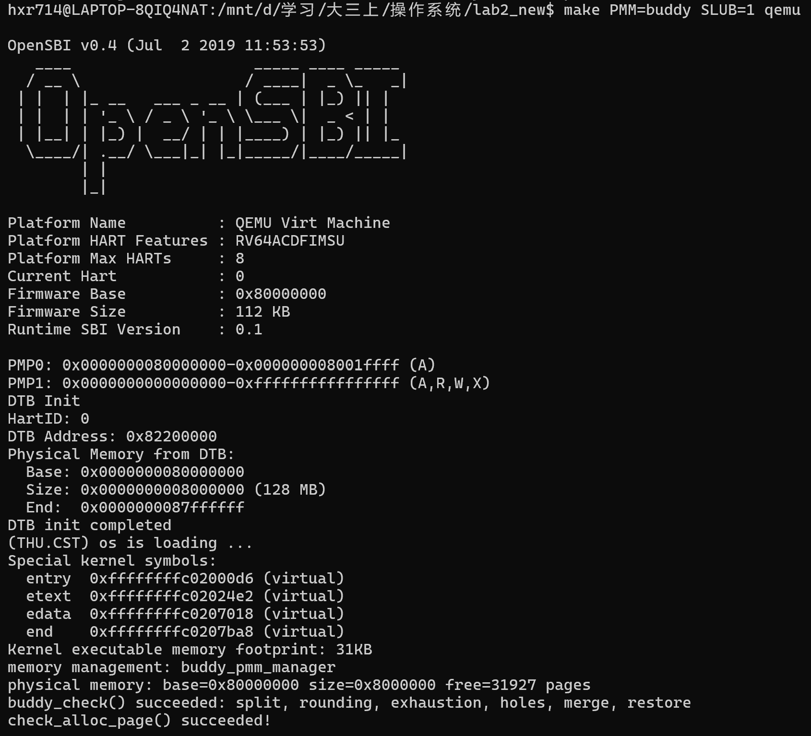
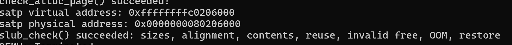

# Lab2 测试证据记录

## 证据来源

以下为用户实际 WSL 输出的关键行摘录，不是重新运行或伪造的截图。
完整控制台记录位于协作会话；新增基础评分截图另存 images/grade-final.png。

伙伴系统启动和检查截图如下，包含 `make PMM=buddy SLUB=1 qemu` 命令、实际管理器名称与 `buddy_check()` 成功行。补充截图直接显示 `slub_check()` 成功行，与下方终端摘录共同记录扩展测试结果。





## Best Fit 加 SLUB

命令：make clean；make SLUB=1；make SLUB=1 qemu。

```text
memory management: best_fit_pmm_manager
physical memory: base=0x80000000 size=0x8000000 free=31927 pages
check_alloc_page() succeeded!
satp virtual address: 0xffffffffc0206000
satp physical address: 0x0000000080206000
slub_check() succeeded: sizes, alignment, contents, reuse, invalid free, OOM, restore
```

## Buddy 加 SLUB

命令：make clean；make PMM=buddy SLUB=1；make PMM=buddy SLUB=1 qemu。

```text
memory management: buddy_pmm_manager
physical memory: base=0x80000000 size=0x8000000 free=31927 pages
buddy_check() succeeded: split, rounding, exhaustion, holes, merge, restore
check_alloc_page() succeeded!
satp virtual address: 0xffffffffc0206000
satp physical address: 0x0000000080206000
slub_check() succeeded: sizes, alignment, contents, reuse, invalid free, OOM, restore
```

## 新增扩展后基础回归评分

```text
-check page init: OK
-check best fit: OK
Total Score: 20/20
```

截图中编译记录包括 buddy_pmm.c 和 slub.c，说明评分副本包含新增源文件；
默认构建关闭SLUB启动检查并选择Best Fit，故评分不等于Buddy/SLUB评分。

## 当前测试限制

没有执行多核并发测试；SLUB OOM为故障注入；Buddy非法释放的致命断言
尚未作为独立进程预期失败用例运行。未声称实现通过所有可能输入。
